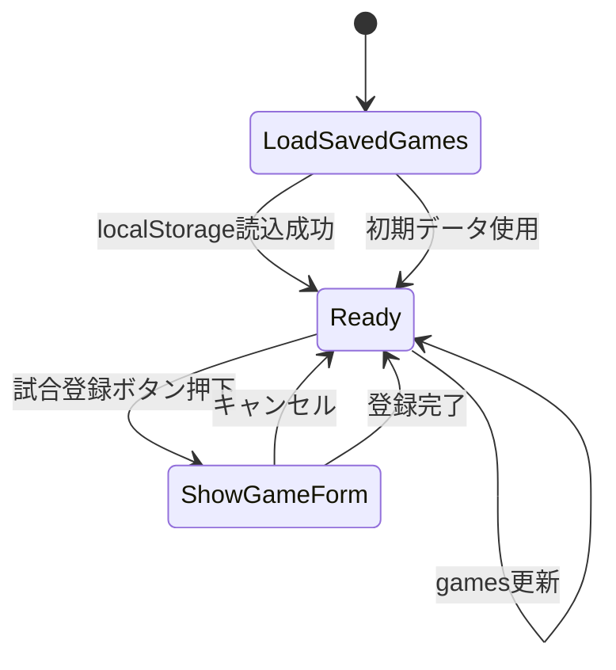

# App 設計書

## 1. 概要

`App` はアプリケーション全体のルートコンポーネントであり、以下の責務を持つ。

- 試合データの初期値と保存処理を管理する
- 試合登録フォームの表示制御を行う
- `GameForm` と `GameResultList` を組み合わせて画面を構成する
- `PlayerList` を描画して選手管理機能を有効化する

## 2. 役割と責務

### 2.1 主要責務

- `games` の状態管理
- `localStorage` からのデータ読み込み
- `localStorage` への保存
- 試合登録フォームの開閉制御
- 新しい試合データの追加

### 2.2 依存先

- `Header`
- `GameForm`
- `GameResultList`
- `PlayerList`

## 図解（Excel風構成）

```text
┌──────────────────────────────────────────────────────────────┐
│ App                                                         │
├──────────────────────────────────────────────────────────────┤
│ Header │ GameForm │ GameResultList │ PlayerList            │
├──────────────────────────────────────────────────────────────┤
│ 画面タイトル │ 試合登録 │ 試合一覧 │ 選手管理               │
├──────────────────────────────────────────────────────────────┤
│ localStorage 読込 │ games状態管理 │ showForm状態管理       │
├──────────────────────────────────────────────────────────────┤
│ 追加操作 │ 保存処理 │ 再描画                                │
└──────────────────────────────────────────────────────────────┘
```

### 処理の流れ

```text
[起動] → [localStorage読込] → [games初期化] → [画面描画]
        ↓
[試合登録ボタン] → [showForm = true] → [GameForm表示]
        ↓
[登録完了] → [handleSubmit] → [games更新] → [GameResultList更新]
        ↓
[保存] → [localStorageへ書き込み]
```

## 3. 状態設計

### 3.1 state

- `showForm: boolean`
  - 試合登録フォームの表示状態
- `games: RegisteredGame[]`
  - 登録済みの試合結果一覧

### 3.2 データモデル

```ts
type RegisteredGame = {
  id: number
  date: string
  homeTeam: string
  awayTeam: string
  location: string
  innings: number
  weather: string
  memo: string
}
```

## 4. データフロー

1. アプリ起動時に `readSavedGames()` を呼び出して localStorage を確認する
2. 保存データがなければ初期データを使用する
3. `games` が変わるたびに `useEffect` で localStorage に保存する
4. 試合登録が完了すると `handleSubmit` が新しいゲームを追加する
5. 新しいデータは `GameResultList` に流れる

## 5. 画面遷移



## 6. 主要処理

### 6.1 `handleSubmit`

- `Omit<RegisteredGame, 'id'>` 形式のデータを受け取る
- 新しい `id` を生成する
- `setGames(prev => [newGame, ...prev])` で配列先頭に追加する
- 登録完了のアラートを表示する
- `showForm` を `false` に戻す

## 7. エラーハンドリング

- `localStorage` の読み込み時に `JSON.parse` が失敗した場合は初期データにフォールバックする
- 画面上で必須項目がない場合は `GameForm` 側で検証する
- App では大域的な補正は行わず、必要な入力検証は子コンポーネントに委譲する

## 8. 設計上の意図

- App は「画面の制御」を担当し、データ処理の詳細は各コンポーネントに分離する
- サブコンポーネントの責務が明確であるため、将来的な追加や修正が容易になる
- localStorage と React state の同期を一元化し、状態の再現性を確保する

## 修正履歴

- 2026-10-25: 初版作成
