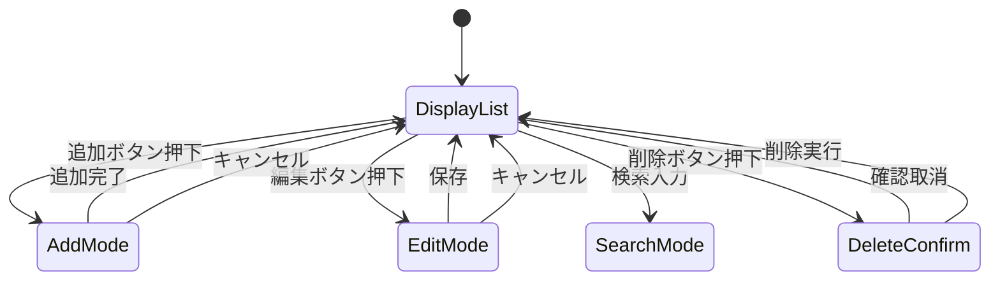

# PlayerList 設計書

## 1. 概要

`PlayerList` は選手管理画面の中心コンポーネントであり、以下の責務を持つ。

- 選手の一覧表示
- 新規追加フォームの表示制御
- 選手の編集モード制御
- 検索機能
- 削除機能
- `localStorage` への保存
- 重複番号チェック

## 2. 役割と責務

### 2.1 主な責務

- `players` の状態管理
- `search` に基づくフィルタ処理
- `showAddForm` と `editingPlayerId` による UI 制御
- 「追加」「編集」「削除」の一連の操作の統合

### 2.2 依存先

- `EditPlayerForm`
- `DeletePlayerButton`
- `FieldError`

## 図解（Excel風構成）

```text
┌──────────────────────────────────────────────────────────────┐
│ PlayerList                                                  │
├──────────────────────────────────────────────────────────────┤
│ 検索入力 │ 追加フォーム │ 編集フォーム │ 削除確認          │
├──────────────────────────────────────────────────────────────┤
│ players状態 │ showAddForm │ editingPlayerId │ error状態    │
├──────────────────────────────────────────────────────────────┤
│ フィルタ処理 │ バリデーション │ setPlayers更新 │ 保存処理 │
├──────────────────────────────────────────────────────────────┤
│ 表示リスト │ 重複ハイライト │ localStorage保存            │
└──────────────────────────────────────────────────────────────┘
```

### 画面遷移

```text
[一覧表示] → [検索入力] → [フィルタ済み配列]
   ↓
[追加ボタン] → [追加フォーム表示] → [バリデーション] → [追加]
   ↓
[編集ボタン] → [EditPlayerForm表示] → [保存] → [更新]
   ↓
[削除ボタン] → [DeletePlayerButton確認] → [削除]
```

## 3. 状態設計

### 3.1 state

- `players: Player[]`
- `search: string`
- `showAddForm: boolean`
- `editingPlayerId: number | null`
- `form: NewPlayerForm`
- `error: string`

### 3.2 型定義

```ts
type Player = {
  id: number
  name: string
  number: number
  position: string
  batHand: string
  throwHand: string
}
```

## 4. 機能詳細

### 4.1 検索機能

検索ワードに対して、以下を対象にマッチングを行う。

- 選手名
- ポジション
- ポジション別名（英語、カタカナ、ひらがな、略記）

検索値は `normalizeSearchText()` で正規化され、比較時に表記ゆれを吸収する。

### 4.2 重複判定

- `players` の背番号を集計して重複番号の集合を作る
- 入力画面と一覧上の行の両方に赤色表示を行う
- 追加時と編集時の両方で重複チェックを実施する

### 4.3 追加処理

- バリデーションを通過した場合に新しい `Player` を生成
- `setPlayers(prev => [newPlayer, ...prev])` で先頭に追加
- `showAddForm` を閉じる

### 4.4 編集処理

- 選択されたプレイヤーを `editingPlayerId` に保持
- `EditPlayerForm` を表示
- 保存時に `setPlayers` で該当データを更新

### 4.5 削除処理

- `DeletePlayerButton` 内で確認ダイアログを表示
- 確認後に `setPlayers` から対象を除外
- 編集中データが削除対象なら編集モードを解除

## 5. 画面遷移



## 6. データ保存

- `useEffect` により `players` の変化時に `localStorage` に保存される
- 保存キーは `baseball-score-app-players`

## 7. 例外処理

- `localStorage` の復元に失敗した場合は `INITIAL_PLAYERS` を採用する
- 空文字や不正な背番号入力時には `error` を設定して処理を中断する
- 重複した番号はユーザーにその旨を明示する

## 8. 設計意図

- 一覧と編集・追加のフォーム状態を切り分けることで、UIの複雑度を抑えている
- バリデーションと状態更新を近い位置に置くことで、予測可能な更新が可能になる
- `localStorage` と state の同期を自動化し、再レンダリング時の破綻を避けている

## 修正履歴

- 2026-10-25: 初版作成
- 2026-10-25: 検索表記の正規化と編集/削除の分離を反映
