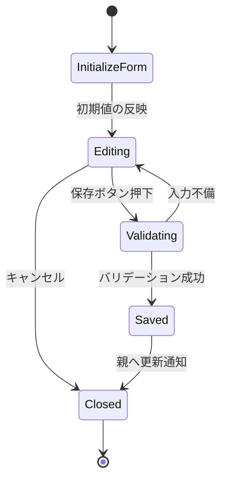

# EditPlayerForm 設計書

## 1. 概要

`EditPlayerForm` は選手の既存情報を編集するための専用フォームである。`PlayerList` から呼ばれ、保存・キャンセルを親コンポーネントへ返す。

## 2. 役割と責務

### 2.1 主な責務

- 対象選手の現在値をフォームへ反映する
- 入力欄の更新を内部 state に保持する
- 編集時のバリデーションを行う
- 保存時に更新後の `Player` を親へ渡す

### 2.2 入力プロパティ

```ts
type EditPlayerFormProps = {
  player: Player
  allPlayers: Player[]
  onSave: (updatedPlayer: Player) => void
  onCancel: () => void
}
```

## 図解（Excel風構成）

```text
┌──────────────────────────────────────────────────────────────┐
│ EditPlayerForm                                              │
├──────────────────────────────────────────────────────────────┤
│ 初期値反映 │ 入力変更 │ バリデーション │ 保存/キャンセル  │
├──────────────────────────────────────────────────────────────┤
│ name │ number │ position │ batHand │ throwHand             │
├──────────────────────────────────────────────────────────────┤
│ エラー表示 │ 重複判定 │ onSave実行 │ 編集終了              │
└──────────────────────────────────────────────────────────────┘
```

### 更新フロー

```text
[既存player受取] → [フォーム初期化] → [入力]
                     ↓
              [重複/空欄チェック]
                     ↓
             [OK] → [onSave(updatedPlayer)]
             [NG] → [FieldError表示]
```

## 3. 状態設計

### 3.1 state

- `form: { name, number, position, batHand, throwHand }`
- `error: string`

### 3.2 初期化

- `player` をもとに `toFormValues()` でフォームの初期値を生成する
- `useState` で保存される

## 4. バリデーション

編集時に行う検証は以下の通りである。

- 選手名が空でないか
- 背番号が 1 以上か
- 数値として解釈可能か
- 自分以外の選手と重複していないか

重複の判定は `allPlayers.some(...)` を使って実施し、自分自身のレコードは除外する。

## 5. 画面遷移



## 6. 処理フロー

1. `player` からフォーム値を生成する
2. 変更時に `handleChange` で state を更新する
3. 保存時に `handleSubmit` を呼ぶ
4. フォームの値を検証する
5. 問題なければ `onSave(updatedPlayer)` を呼ぶ
6. 親側で `players` 配列の該当データを更新する

## 7. エラー表示

- エラー文言は `FieldError` コンポーネントへ委譲する
- 入力欄ごとに赤枠を付与する
- 重複時も「別の背番号を選んでください」と明示する

## 8. 設計意図

- 編集フォームを独立化することで、一覧画面と編集画面の責務を分離している
- 親側の状態更新ロジックを埋め込まず、保存処理だけを渡すことで再利用性が高い
- バリデーションと入力フォームを同コンポーネントで持つことで、エラー箇所の特定がしやすい

## 修正履歴

- 2026-10-25: 初版作成
