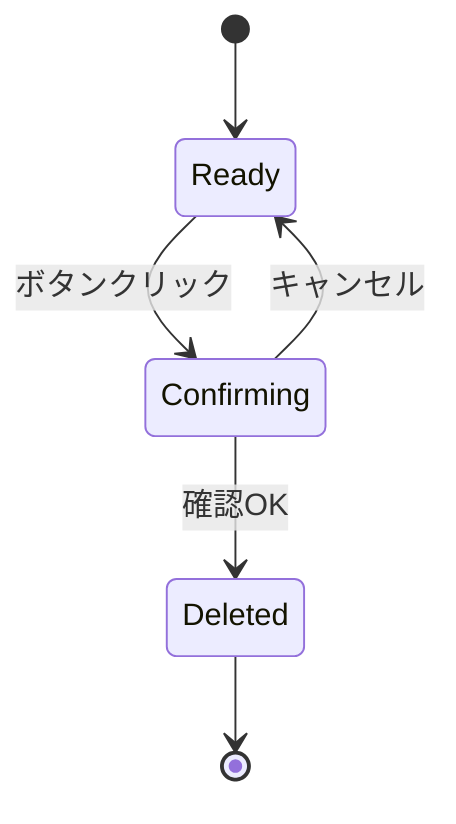

# DeletePlayerButton 設計書

## 1. 概要

`DeletePlayerButton` は選手削除時の確認ダイアログと削除実行を担当するボタンコンポーネントである。

## 2. 役割と責務

### 2.1 主な責務

- 削除ボタンの表示
- 確認ダイアログの表示
- 確認後に親コンポーネントへ削除イベントを通知する

### 2.2 入力プロパティ

```ts
type DeletePlayerButtonProps = {
  playerName: string
  playerNumber: number
  onDelete: () => void
}
```

## 図解（Excel風構成）

```text
┌──────────────────────────────────────────────────────────────┐
│ DeletePlayerButton                                          │
├──────────────────────────────────────────────────────────────┤
│ ボタンクリック │ 確認ダイアログ │ OK/NG判定 │ 実行/中止    │
├──────────────────────────────────────────────────────────────┤
│ playerName │ playerNumber │ onDelete │ 削除処理              │
├──────────────────────────────────────────────────────────────┤
│ 確認済みなら親へ通知 │ キャンセルなら何もしない            │
└──────────────────────────────────────────────────────────────┘
```

### 判定フロー

```text
[クリック] → [window.confirm] → [OK?]
            ↓
         [Yes] → [onDelete()]
         [No] → [終了]
```

## 3. 状態設計

本コンポーネントは明示的な `state` を持たず、以下の状態をイベントとして表現する。

- 初期状態: 待機中
- 確認中: `window.confirm` を表示
- 成功: `onDelete` を呼ぶ
- キャンセル: 処理終了

## 4. 画面遷移



## 5. 処理の流れ

1. ユーザーが削除ボタンを押す
2. `window.confirm` を起動する
3. メッセージに選手名と背番号を含める
4. 確認が OK の場合のみ `onDelete()` を呼ぶ
5. 親側で `players` 配列から対象を削除する

## 6. 設計意図

- 削除は誤操作のリスクが高い行為のため、確認ダイアログを明示的に分離した
- 親コンポーネントから削除ロジックを切り離し、再利用性を確保した
- 視覚的にどの選手を削除しようとしているかが分かる設計にしている

## 7. エラーハンドリング

- 確認ダイアログでキャンセルした場合は何も実行しない
- 親からの削除処理が失敗しても、ここでは状態管理を持たないため責務を限定している

## 修正履歴

- 2026-10-25: 初版作成
