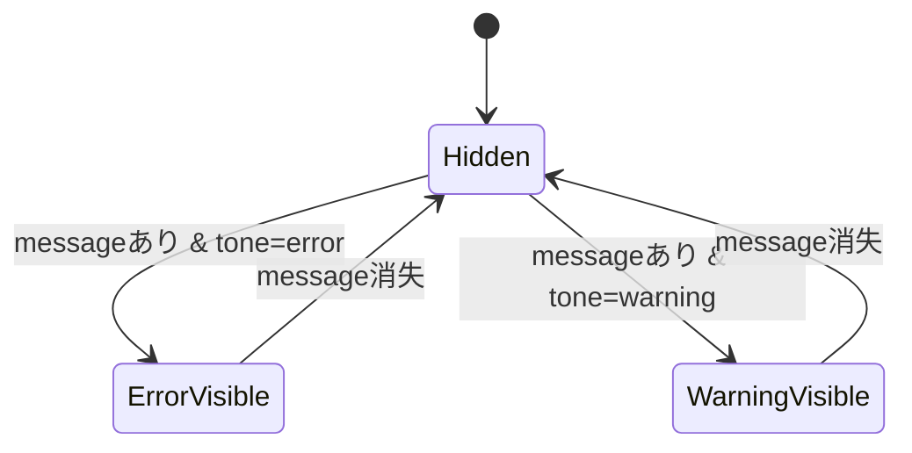

# FieldError 設計書

## 1. 概要

`FieldError` は、フォーム関連のエラーメッセージ表示を共通化するための軽量コンポーネントである。

## 2. 役割と責務

### 2.1 主な責務

- エラーメッセージの表示
- 警告表示の切り替え
- `role="alert"` を付与してアクセシビリティを確保する

### 2.2 入力プロパティ

```ts
type FieldErrorProps = {
  message?: string
  tone?: 'error' | 'warning'
}
```

## 図解（Excel風構成）

```text
┌──────────────────────────────────────────────────────────────┐
│ FieldError                                                 │
├──────────────────────────────────────────────────────────────┤
│ message存在確認 │ tone設定 │ 表示/非表示 │ 色分け        │
├──────────────────────────────────────────────────────────────┤
│ error-box │ warning-box │ role="alert" │ テキスト表示     │
└──────────────────────────────────────────────────────────────┘
```

### 判定フロー

```text
[message受け取り] → [空か判定]
         ↓
       [空] → [null]
       [あり] → [error/warning表示]
```

## 3. 状態設計

- 親コンポーネントが `message` を渡す
- `message` が空の場合は `null` を返す
- `tone` が `error` なら赤系、`warning` なら黄系のスタイルを使用する

## 4. 画面遷移



## 5. 表示仕様

- `message` が存在しない場合は何も表示しない
- `error-box` / `warning-box` により視覚的な差分を付ける
- テキストは `error` / `warning` クラスで制御する

## 6. 設計意図

- エラー UI を再利用することで、各フォームの表現を統一している
- アプリ全体で「エラーの見た目」を揃え、ユーザーの視認性を向上させている
- Form 側は表示制御の詳細を意識せずにメッセージだけを渡せばよい

## 7. エラー処理

- `message` が空文字の場合は表示しない
- `warning` は将来的な注意表示に備えた汎用的な拡張設計を採用している

## 修正履歴

- 2026-10-25: 初版作成
