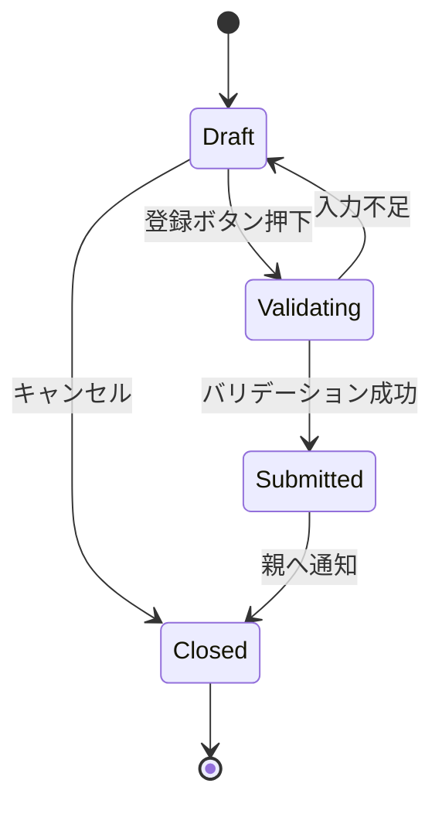

# GameForm 設計書

## 1. 概要

`GameForm` は試合登録フォームであり、試合内容とイニング別得点の入力、入力値の検証を担当する。登録が完了したら親コンポーネントへ結果を渡す。

## 2. 役割と責務

### 2.1 主な責務

- 試合日、ホーム／アウェーチーム名、場所、天気、メモの入力
- 7回または9回の各イニングの得点入力と合計表示
- チーム名をスコアボードの行見出しに反映
- 必須入力項目の検証
- 登録ボタン押下時の親コンポーネントへの通知
- キャンセル時の閉じる処理

### 2.2 入力プロパティ

```ts
type Props = {
  onSubmit: (data: GameFormData) => void
  onCancel: () => void
}
```

## 図解（Excel風構成）

```text
┌──────────────────────────────────────────────────────────────┐
│ GameForm                                                   │
├──────────────────────────────────────────────────────────────┤
│ 試合日 │ チーム名 │ 場所 │ イニング数 │ 天気 │ メモ │
├──────────────────────────────────────────────────────────────┤
│ イニング別得点入力 │ チーム別合計 │ バリデーション │ 登録 │
├──────────────────────────────────────────────────────────────┤
│ onSubmit │ onCancel │ Appへ送信                            │
└──────────────────────────────────────────────────────────────┘
```

### 検証フロー

```text
[入力] → [validate()] → [必須項目確認]
        ↓
   [OK] → [onSubmit(form)]
   [NG] → [error表示]
```

## 3. 状態設計

### 3.1 state

- `form: GameFormData`
- `errors: Partial<GameFormData>`

### 3.2 型定義

```ts
type GameFormData = {
  date: string
  homeTeam: string
  awayTeam: string
  location: string
  innings: number
  homeScores: number[]
  awayScores: number[]
  weather: string
  memo: string
}
```

## 4. バリデーション

`validate()` で以下を確認する。

- 試合日が必須か
- ホームチーム名が必須か
- アウェイチーム名が必須か

必須項目が不足している場合は `errors` に格納し、`false` を返す。

## 5. 画面遷移



## 6. 主要処理

### 6.1 `handleChange`

- 入力イベントから `name` と `value` を取り出す
- チーム名を更新すると、スコアボードの行名も同じ state から更新される
- イニング数を変更すると得点配列の長さを調整し、既存の入力値を保つ

### 6.2 `handleScoreChange`

- ホームまたはアウェーの指定イニングの得点だけを更新する
- 0以上の整数のみを受け付ける
- 各チームの合計点は入力値から算出して表示する

### 6.3 チーム名とスコアボード

- 「ホームチーム」「アウェイチーム」欄は編集可能
- 入力したチーム名は、直下のスコアボード行見出しへ即時反映する
- 登録後はチーム名とイニング別得点が試合データとして保存される

### 6.4 `handleSubmit`

- `validate()` を呼ぶ
- 成功時のみ `onSubmit(form)` を実行する

## 7. エラー表示

- `errors.date`, `errors.homeTeam`, `errors.awayTeam` の値がある場合にメッセージを表示する
- フォーム直下に赤文字のメッセージを出す

## 8. 設計意図

- 試合登録の入力と検証を一つのフォームとしてまとめている
- 親コンポーネントからは「登録完了」「キャンセル」だけを受け取り、フォーム内のロジックを閉じている
- 将来的にスコア入力や詳細項目追加を行う際にも、フォームの構造を拡張しやすい

## 修正履歴

- 2026-10-25: 初版作成
- 2026-11-01: イニング別得点、合計表示、チーム名のスコアボード反映を追加
