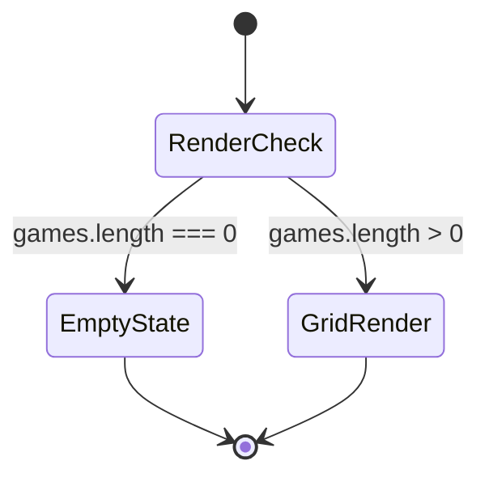

# GameResultList 設計書

## 1. 概要

`GameResultList` は登録済みの試合結果をカード形式で表示するコンポーネントである。`App` から `games` を受け取り、一覧の描画を行う。

## 2. 役割と責務

### 2.1 主な責務

- 試合結果の一覧表示
- 日付フォーマットの整形
- 空状態時の表示
- 各試合カードのレイアウト作成

### 2.2 入力プロパティ

```ts
type Props = {
  games: GameResult[]
}
```

## 図解（Excel風構成）

```text
┌──────────────────────────────────────────────────────────────┐
│ GameResultList                                             │
├──────────────────────────────────────────────────────────────┤
│ games.length=0           │ games.length>0                    │
├──────────────────────────────────────────────────────────────┤
│ empty-state             │ game-card × N                   │
├──────────────────────────────────────────────────────────────┤
│ 日付 │ 対戦カード │ 場所 │ イニング │ 天気 │ メモ           │
└──────────────────────────────────────────────────────────────┘
```

### 画面出力フロー

```text
[games受取] → [長さ判定]
      ↓
  [0件] → [empty-state]
  [1件以上] → [カード描画]
```

## 3. 状態設計

- `state` は持たない
- 表示は props の `games` をそのまま使用する

## 4. 画面遷移



## 5. 主要処理

### 5.1 `formatDate`

- `date` を `YYYY-MM-DD` 形式から日本語表記の日付へ変換する
- 無効な日付ならそのまま表示する

### 5.2 表示内容

各カードには以下を表示する。

- 日付
- ホームチーム vs アウェイチーム
- 場所
- イニング数
- 天気
- メモ

## 6. エラーハンドリング

- `games` が空配列のときは `empty-state` を表示する
- 日付が不正な値の場合でもアプリが落ちないよう `Number.isNaN` での判定を行う

## 7. 設計意図

- 表示とデータ処理を簡潔に分離している
- 画面の骨格を維持しつつ、空状態まで含めて使いやすくしている
- 将来的にスコア表示や成績連携を追加しやすい構造である

## 修正履歴

- 2026-10-25: 初版作成
