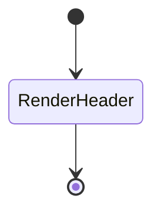

# Header 設計書

## 1. 概要

`Header` はアプリのタイトル部分を表示するシンプルなコンポーネントである。

## 2. 役割と責務

- アプリ名の表示
- 全体画面の見出し役割を担う

## 図解（Excel風構成）

```text
┌──────────────────────────────────────────────────────────────┐
│ Header                                                    │
├──────────────────────────────────────────────────────────────┤
│ タイトル表示                                               │
├──────────────────────────────────────────────────────────────┤
│ 草野球スコア管理アプリ                                    │
└──────────────────────────────────────────────────────────────┘
```

## 3. 状態設計

- `state` を持たない
- 表示専用コンポーネント

## 4. 画面遷移



## 5. 構成

```tsx
<header>
  <h1>⚾ 草野球スコア管理アプリ</h1>
</header>
```

## 6. 設計意図

- 画面の入口に位置し、アプリのタイトルを統一して表示する
- サブコンポーネントに依存せず軽量である

## 修正履歴

- 2026-10-25: 初版作成
